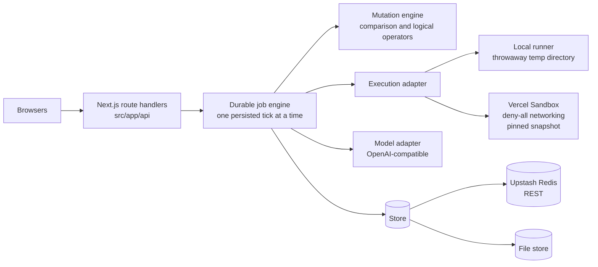

# FalseGreen

Find the mistakes your passing tests would let through.

> Your AI wrote the code. Your AI wrote the tests. Everything passed. We check
> what those tests missed.

FalseGreen takes one JavaScript module, one Vitest suite, and the requirement
the module is supposed to satisfy. It mutates comparison and logical operators,
runs the submitted suite against each mutant, and reports which changes the
tests cannot detect. For a missed change it asks a configured open model for one
requirement-derived regression test, then executes a four-run verification
matrix. Only a test that passes on the original and fails on the mutant at its
own assertion is offered as a verified repair.

## What it does in four steps

1. **Validate and mutate.** The module must be a self-contained ES module with
   at least one named synchronous function export. FalseGreen parses it and
   collects deterministic operator mutations: `>=` to `>`, `>` to `>=`, `<=` to
   `<`, `<` to `<=`, `===` to `!==`, `!==` to `===`, `&&` to `||`, and `||` to
   `&&`.
2. **Run the baseline.** The submitted Vitest suite runs against the submitted
   module. If the suite fails, runs zero tests, errors, or times out, the scan
   stops before mutating. A failing suite cannot distinguish versions.
3. **Run every mutant.** Each mutant runs with the existing tests. A failing
   test means the mutant was caught. All tests passing means it was missed.
   Timeouts and execution errors are recorded but never counted as caught.
4. **Propose and verify.** For a missed mutation, the model returns a JSON
   proposal, not code. FalseGreen validates it, renders it through a fixed
   Vitest template, and runs original plus existing, mutant plus existing,
   original plus existing and proposed, and mutant plus existing and proposed.
   Only a failure on the proposed assertion in the final run is a verified
   repair.

## The ₹1,000 worked example

The app opens on the `missed-boundary` preset. These are the exact inputs.

**Requirement**

> Orders of ₹1,000 or more receive free shipping. Orders below ₹1,000 pay ₹99
> shipping.

**source.js**

```js
export function shippingFee(orderTotal) {
  return orderTotal >= 1000 ? 0 : 99;
}
```

**source.test.js**

```js
import { expect, test } from "vitest";
import { shippingFee } from "./source.js";

test("charges shipping below the threshold", () => {
  expect(shippingFee(500)).toBe(99);
});

test("gives free shipping above the threshold", () => {
  expect(shippingFee(1500)).toBe(0);
});
```

**What the demo shows**

- Both existing tests pass against the submitted module. The baseline is two
  passing tests.
- The boundary mutation turns `>=` into `>`. Both tests still pass, because they
  only exercise 500 and 1500. That mutation is missed. The comparison mutation
  `>=` to `<` is caught by the below-threshold test, so the scan reports `1 of 2
  tested mutations caught`.
- The missed boundary is exactly ₹1,000. The tests never call the function with
  the threshold value.
- With a model configured, the model proposes:

  ```json
  {
    "title": "gives free shipping at exactly 1000",
    "exportName": "shippingFee",
    "args": [1000],
    "expected": 0,
    "rationale": "The requirement includes 1,000, so 1,000 should return 0."
  }
  ```

  The fixed template renders:

  ```js
  import { expect, test } from "vitest";
  import { shippingFee } from "./source.js";

  test("gives free shipping at exactly 1000", () => {
    expect(shippingFee(1000)).toBe(0);
  });
  ```

- The verification matrix passes: original plus existing tests pass, mutant plus
  existing tests pass, original plus existing and proposed tests pass, and mutant
  plus existing and proposed tests fail on the proposed assertion with `expected
  99 to be 0`. The repair is verified.
- Three downloads unlock only after verification: the generated regression test,
  a `git apply`-compatible patch that adds `source.regression.test.js`, and the
  evidence JSON containing the run record, proposal, and matrix.

Without a model, the scan and mutation list still work. The repair button is
disabled and explains which variables are missing.

## Test gap or requirement mismatch

A missed mutation only says the existing tests cannot tell two versions apart.
The requirement decides whether the missing test is a gap in the tests or a
conflict in the implementation.

| Situation | Requirement | `source.js` | Proposed `shippingFee(1000)` | Result |
| --- | --- | --- | --- | --- |
| Test gap | ₹1,000 or more ships free | `orderTotal >= 1000` | Passes on the original, fails on the `>` mutant | Verified repair |
| Requirement mismatch | ₹1,000 or more ships free | `orderTotal > 1000` | Fails on the original with `expected 99 to be 0` | Requirement mismatch, no repair |
| Requirement mismatch | Above ₹1,000 ships free | `orderTotal >= 1000` | Fails on the original with `expected 0 to be 99` | Requirement mismatch, no repair |

In the test-gap case the implementation already matches the requirement. The
tests are missing a boundary, so adding the boundary test is enough.

In the mismatch case the implementation contradicts the stated requirement. The
proposed requirement-derived test fails against the original code, so no test
can repair the difference. The interface shows the requirement, input, expected
value, and observed value, and offers no download. Change the implementation or
restate the requirement, then run a new check.

FalseGreen never infers the intended behaviour from the implementation. The
requirement is the only source of intent.

## Quick start

Targets Node 24 and npm. The repository does not declare `engines`, so pin the
runtime in your environment.

```bash
npm install
npm run dev
```

Open `http://localhost:3000`. The playground loads the `missed-boundary` preset.
Press `Cmd/Ctrl + Enter` or select **Check my tests**.

Scanning works without a model. Repair requires an OpenAI-compatible model:

```bash
MODEL_API_BASE_URL=https://your-model-endpoint.example/v1 \
MODEL_API_KEY=replace-with-a-real-key \
MODEL_ID=your-model-id \
npm run dev
```

A local server that accepts an empty key can be used with `MODEL_API_KEY` unset.
The server treats a model as configured when a base URL and model id are present.
Repairs send `temperature: 0`, request JSON output, allow two attempts by
default, and validate every field before anything is rendered or executed.

Other commands:

```bash
npm test          # repository test suite
npm run build     # production build
npm start         # serve the production build
npm run demo      # offline scenario run with a scripted stand-in model
```

`npm run demo` replays the four presets with the local runner. It uses a
deterministic stand-in model, calls no network, and exits non-zero if any
scenario does not match its expectation.

## Environment variables

Most variables below are read by `loadConfig()` in `src/core/config.js`.
`NODE_ENV` is read by the session layer; provisioning-only and CLI-only
variables are marked.

| Variable | Default | Purpose |
| --- | --- | --- |
| `NODE_ENV` | unset | Set by the runtime. `production` marks the session cookie `secure`. |
| `VERCEL` | platform-managed | When set, execution defaults to `sandbox` and the job driver defaults to `vercel-workflow`. Do not set it locally. |
| `EXECUTION_DRIVER` | `local` | `local` or `sandbox`. Defaults to `sandbox` when `VERCEL` is set. |
| `VERCEL_SANDBOX_SNAPSHOT_ID` | empty | Snapshot containing Node and Vitest at `/opt/falsegreen`. Required for the sandbox runner. |
| `VERCEL_SANDBOX_RUNTIME` | `node24` | Read into config. The sandbox runner does not consume it; the snapshot fixes the runtime. The snapshot script reads `FG_SANDBOX_RUNTIME`. |
| `FG_KEEP_LOCAL_ARTIFACTS` | `0` | Set to `1` to keep the local runner's temp directory for debugging. |
| `STORE_DRIVER` | `file` | `file` or `redis`. Defaults to `redis` when both Upstash values are present. |
| `UPSTASH_REDIS_REST_URL` | empty | Upstash Redis REST URL. HTTPS only. |
| `UPSTASH_REDIS_REST_TOKEN` | empty | Upstash Redis REST token. Server-side only. |
| `FG_DATA_DIR` | `os.tmpdir()/falsegreen-data` | Directory for the file store. |
| `MODEL_DRIVER` | `auto` | `auto`, `openai-compatible`, `ollama`, or `unconfigured`. `auto` resolves to `openai-compatible` when a base URL and model id are set. |
| `MODEL_API_BASE_URL` | empty | OpenAI-compatible base URL, with or without a trailing `/v1`. |
| `MODEL_API_KEY` | empty | Bearer token for the model endpoint. Never sent to a sandbox or the browser. |
| `MODEL_ID` | empty | Model name sent in the chat-completions request. |
| `MODEL_TIMEOUT_MS` | `45000` | Per-request model timeout. |
| `MODEL_MAX_TOKENS` | `900` | Maximum generated tokens for a proposal. |
| `JOB_DRIVER` | `inline` | `inline` or `vercel-workflow`. Defaults to `vercel-workflow` on Vercel and `inline` elsewhere. The workflow driver falls back to inline if a workflow cannot start. |
| `FG_MAX_MUTATIONS` | `12` | Maximum mutations collected per run. |
| `FG_MAX_ACTIVE_JOBS` | `2` | Global job slots shared by scans and repairs. |
| `FG_MAX_MODEL_ATTEMPTS` | `2` | Model attempts per repair request. |
| `FG_TEST_TIMEOUT_MS` | `10000` | Per-execution timeout passed to Vitest and the runner. |
| `FG_SCAN_DEADLINE_MS` | `180000` | Scan deadline. Remaining mutations become `untested`. |
| `FG_REPAIR_DEADLINE_MS` | `120000` | Repair deadline, including model attempts and verification. |
| `FG_RUN_TTL_MS` | `86400000` | Run record lifetime in the store, 24 hours. |
| `FG_MAX_RUNS_PER_SESSION_PER_HOUR` | `20` | Per-browser-session run creation limit. |
| `FALSEGREEN_URL` | `http://localhost:3000` | CLI base URL when `--url` is omitted. |

`MODEL_DRIVER=ollama` is an alias for `openai-compatible` with a default base URL
of `http://127.0.0.1:11434/v1`. `MODEL_ID` is still required.

Fixed limits are not environment-configurable: source and tests are 64 KiB each,
the requirement is 4 KiB, proposed args are 4 KiB, captured output is 64 KiB, API
request bodies are 256 KiB, and the UI polls every 700 ms.

Provisioning-only variables for `scripts/build-sandbox-snapshot.mjs`:
`VERCEL_OIDC_TOKEN`, or `VERCEL_TOKEN` with `VERCEL_TEAM_ID` and
`VERCEL_PROJECT_ID`; optional overrides `FG_SANDBOX_RUNTIME` and
`FG_VITEST_VERSION`. See `docs/deployment.md`.

## Architecture



The engine under `src/core/` has no Next.js imports. Route handlers validate the
HTTP shape, read the session, and schedule the job loop. All run state lives in
the store. Every tick performs one bounded step, persists the run, and returns.

## Supported scope

- One self-contained ES module, submitted as `source.js`.
- One Vitest file, submitted as `source.test.js`.
- Named synchronous function exports: `export function f() {}`,
  `export const f = () => {}`, or `export const f = function () {}`.
- Vitest only. The test file must import from `./source.js`.
- Operator mutations in `>=`, `>`, `<=`, `<`, `===`, `!==`, `&&`, and `||`.
- One implementation file and one test file per run.

## Explicit non-goals

- TypeScript.
- Multi-file modules, re-exports, or imports.
- Mocks, spies, or `vi.mock` and `vi.hoisted`.
- Browser, DOM, component, or end-to-end tests.
- Async or generator exports, and default exports.
- Authentication, accounts, or per-user history.
- Billing.
- Automatic pull requests.
- Automatic source fixes. FalseGreen proposes a regression test and an additive
  patch. It does not edit the implementation.

## Verification vocabulary

| Term | Meaning |
| --- | --- |
| Caught | An existing test failed against the mutant. |
| Missed | All existing tests still passed against the mutant. |
| Timed out | The mutant run exceeded its timeout. Never counted as caught. |
| Execution error | The mutant could not run, for example a compile or import failure. Never counted as caught. |
| Untested | The mutation was collected but not run, usually because the scan deadline passed. Never counted as caught. |
| Verified repair | Original plus existing passes, mutant plus existing passes, original plus existing and proposed passes, and mutant plus existing and proposed fails on the proposed assertion. |
| Requirement mismatch | The proposed requirement-derived test fails against the original implementation. No repair is offered. |

A surviving mutation means the tests cannot distinguish two versions. It is not
proof of a bug. A caught mutation is not proof of correctness.

## API

All responses are JSON except artifact downloads, all are `Cache-Control:
no-store`, and run routes require the `fg_session` cookie. Another session's run
returns `404`, not `403`.

| Method | Path | Purpose | Success | Common errors |
| --- | --- | --- | --- | --- |
| `POST` | `/api/runs` | Validate `{ requirement, source, tests }`, create a run, and start the scan. | `201 { runId, run }` | `400` invalid input, `413` body too large, `415` not JSON, `429` session rate limit |
| `GET` | `/api/runs/:id` | Read the run record, including baseline, mutations, scan summary, and repair. | `200 { run }` | `404` missing, expired, or another session |
| `POST` | `/api/runs/:id/repairs` | Request a repair for one missed mutation with `{ mutationId }`. | `202 { run }` | `400` missing mutation id, `404`, `409` run not complete, repair running, run busy, or mutation not missed, `503` no model |
| `POST` | `/api/runs/:id/cancel` | Stop a running or queued run after the current execution finishes. | `202 { run }` | `404` missing or another session |
| `GET` | `/api/runs/:id/artifacts/:name` | Download a verified artifact. Names: `test`, `patch`, `evidence`, or the full filenames. | `200` attachment | `403` repair not verified, `404` unknown artifact or run |
| `GET` | `/api/config` | Read public configuration and presets. No secrets. | `200 { config, presets }` | `500` unexpected failure |

Artifact content types are `text/javascript`, `text/x-patch`, and
`application/json`. The patch adds `source.regression.test.js` and does not
modify `source.js`.

## CLI

The CLI entrypoint is `bin/falsegreen.js`. Install the command with `npm link`,
or call `node bin/falsegreen.js` directly.

```bash
falsegreen check --source <path> --tests <path> --requirement <text|@file> [options]
falsegreen scan  --source <path> --tests <path> --requirement <text|@file> [options]
```

`check` scans, then proposes and verifies one repair. `scan` stops after the
scan, does not request a repair, and does not save artifacts.

| Option | Meaning |
| --- | --- |
| `--source <path>` | ES module to mutate. Required. |
| `--tests <path>` | Vitest file for the module. Required. |
| `--requirement <value>` | Stated behaviour. Use `@file` to read it from a file. Required. |
| `--url <base>` | Server base URL. Defaults to `FALSEGREEN_URL` or `http://localhost:3000`. |
| `--out <dir>` | Artifact directory. Defaults to `./falsegreen-artifacts`. |
| `--mutation <id>` | Repair this missed mutation instead of the first one. |
| `--apply` | Run `git apply` on the verified patch. |
| `--yes` | Skip the apply confirmation prompt. |
| `--json` | Print the final run record to stdout. Human progress goes to stderr. |

Examples:

```bash
falsegreen scan \
  --source source.js \
  --tests source.test.js \
  --requirement @requirement.txt \
  --json > scan.json
```

```bash
falsegreen check \
  --source source.js \
  --tests source.test.js \
  --requirement @requirement.txt \
  --mutation m1 \
  --out artifacts \
  --apply --yes
```

`check` saves `falsegreen.generated.test.js`, `falsegreen.patch`, and
`falsegreen.evidence.json` only when the repair is verified. `--apply` needs a
git work tree. The session cookie is stored at `~/.falsegreen/session` with mode
`0600`.

Exit codes:

- `0`: a verified repair, or a scan completed cleanly with no missed mutations.
- `1`: usage, transport, or HTTP error, including a missing model when a repair
  is requested.
- `2`: the scan found missed mutations, the baseline did not complete cleanly, or
  no repair was verified. A scan that finds a missed mutation is not a transport
  failure.

`check` needs a configured model when it reaches a repair. `scan` works without
one. See `docs/alan-workflow.md` for a full session script.

## Docker

The repository ships a multi-stage `Dockerfile` based on Node 24 Debian slim,
a `.dockerignore`, and `docker-compose.yml`.

Create `.env` from `.env.example`, or omit `--env-file` if you do not need model
settings. The image defaults to the file store and local runner.

```bash
docker build -t falsegreen .
docker run --rm -p 3000:3000 --env-file .env falsegreen
```

```bash
docker compose up --build
```

The image serves the Next standalone `server.js` as the non-root `node` user. It
sets `EXECUTION_DRIVER=local`, `STORE_DRIVER=file`, and `FG_DATA_DIR=/data`, and
copies the project `node_modules` so the local runner can resolve
`node_modules/vitest/vitest.mjs`. Mount `/data` to keep run records across
container restarts. The container healthcheck requests `/api/config`.

Compose mounts the `falsegreen-data` volume, reads `.env` when present, and by
default uses the same file store and local runner. The `.dockerignore` keeps
`.env` files and host build artifacts out of the image. Upstash is a REST
service, so compose does not need a Redis container. For multi-instance or
untrusted traffic, set `STORE_DRIVER=redis` with Upstash and
`EXECUTION_DRIVER=sandbox` with the required Vercel Sandbox credentials and
snapshot.

## Isolation and security

- Each local execution creates a new directory under `os.tmpdir()` with
  `fs.mkdtemp`, writes `source.js`, `source.test.js`, `package.json`, and a
  Vitest config, symlinks the project `node_modules`, and spawns Node with a
  minimal environment: `PATH`, `HOME`, `TMPDIR`, `NODE_ENV=test`, and `CI=1`.
  The temp directory is removed in `finally` unless `FG_KEEP_LOCAL_ARTIFACTS=1`.
  The process group is killed on timeout on Unix; Windows kills the child.
- The local runner provides separate temp directories and a minimal environment.
  It does not provide a network namespace, a container, or a separate OS user.
  Submitted code runs as the app process user and can reach anything that user
  can reach, including the network. Treat the local runner as a development
  convenience, not a security boundary.
- The Vercel Sandbox runner creates a sandbox from a pinned snapshot with
  `networkPolicy: "deny-all"` and `ports: []`, writes files under
  `/tmp/falsegreen/run`, runs Vitest there, reads the JSON report, and stops the
  sandbox in `finally`. Model keys and other secrets are never written into the
  sandbox. Credentials come from the platform.
- Model output is untrusted data. A proposal must be a JSON object with exactly
  `title`, `exportName`, `args`, `expected`, and `rationale`. Extra keys, code
  strings, mocks, non-JSON values, unknown exports, and oversized arguments are
  rejected. The test is rendered by a fixed template. `exportName` must match an
  exported function, the title is sanitized, and args and expected are
  JSON-serialized literals. The model cannot inject test source.
- The session cookie is an httpOnly, sameSite lax UUID, secure in production,
  valid for 30 days. Run ownership is enforced with a `404` for other sessions.
- API bodies are limited to 256 KiB and must be JSON. Source and tests are
  limited to 64 KiB each, the requirement to 4 KiB, and captured output to
  64 KiB.
- Each execution runs in its own throwaway directory or sandbox. Runs do not
  share a working directory.

## Honest limitations

- Only one module and one Vitest file. No TypeScript, multi-file modules,
  imports, mocks, browser tests, async functions, generators, or default exports.
- Only eight operators are mutated. Code without those operators produces no
  mutations, and the scan reports `no_mutations` rather than a verdict.
- A surviving mutation means the tests cannot distinguish two versions. It is
  not proof of a bug. A timeout or execution error is never evidence of a caught
  mutation.
- The repair is one regression test. It is not a fix, it does not prove the rest
  of the module is correct, and it is not applied to your repository unless you
  run `git apply` or use the CLI `--apply` flow.
- A model is required for repair. If it is unconfigured, returns invalid data on
  every allowed attempt, times out, or exceeds the repair deadline, no verified
  repair is produced.
- The local runner is not isolated from the network or the host user. Use the
  sandbox runner for untrusted public traffic.
- The file store is intended for local and single-instance use. Use Upstash Redis
  for multi-instance production.
- The inline driver (`JOB_DRIVER=inline`) runs inside the server process. State is
  durable, but a process restart leaves an unfinished run queued. Use the
  Workflow SDK driver (`JOB_DRIVER=vercel-workflow`) for automatic resumption in
  production. Locally and in Docker the inline driver is the default.
- The local file store is single-host. Use Upstash Redis for more than one
  instance.
- Cancellation stops the run after the current execution finishes; a sandbox or
  local temp directory is removed by that execution's cleanup path.
- `npm run demo` uses a deterministic scripted stand-in model, not a real model.
  It calls no network. Production repairs use the configured model endpoint.
- There is no authentication, billing, account history, automatic pull request,
  or automatic source edit. The session cookie only separates browser sessions.

## Built for the OpenFire Hackathon

FalseGreen was built for the OpenFire Hackathon. Alan writes and reviews the
product and drives the verification loop described in
`docs/alan-workflow.md`. A configured open model
proposes candidate regression tests. Execution decides what is verified: the
model never writes executable code, and its proposal is only data until the
matrix confirms it.

Reference documentation used by the execution design:

- Vercel Sandbox: https://vercel.com/docs/vercel-sandbox
- Workflow SDK: https://workflow-sdk.dev

Two drivers are wired. `src/workflows/scan.js` defines `runScanWorkflow` and
`runRepairWorkflow`; every engine tick is a workflow step, so progress survives a
function restart. Route handlers start the workflow with `start()` on Vercel. When
the workflow cannot start, the same tick loop runs inline through `after()`.
See `docs/deployment.md` for the production configuration.

## License

MIT. See `LICENSE`.

Copyright (c) 2026 FalseGreen contributors.
